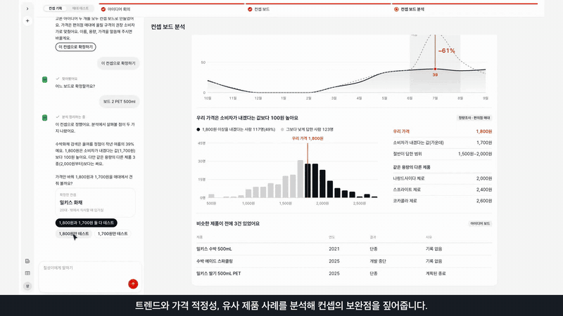
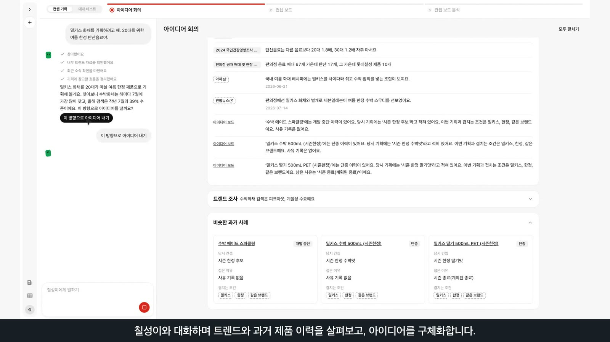
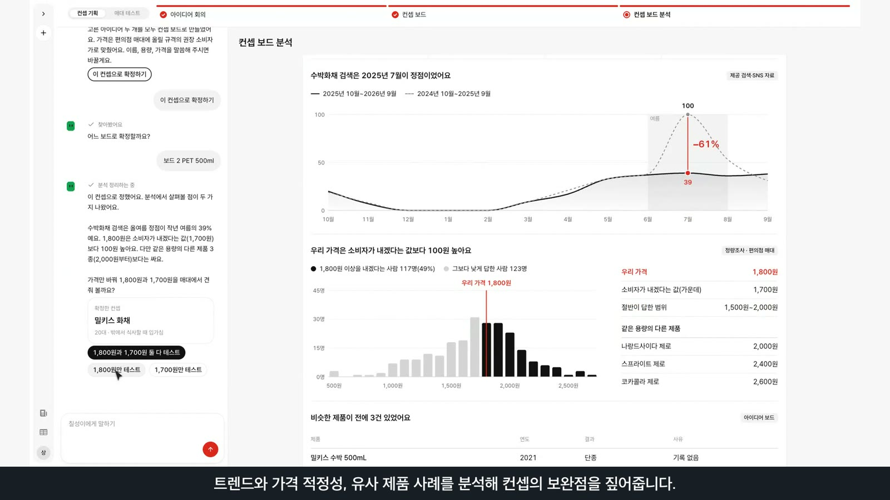
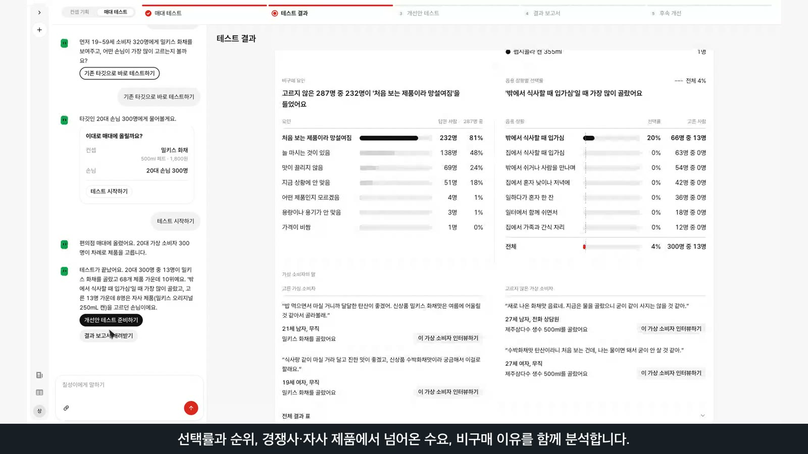
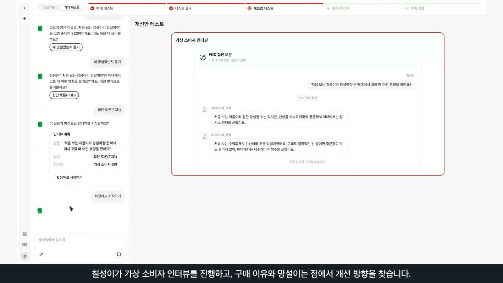
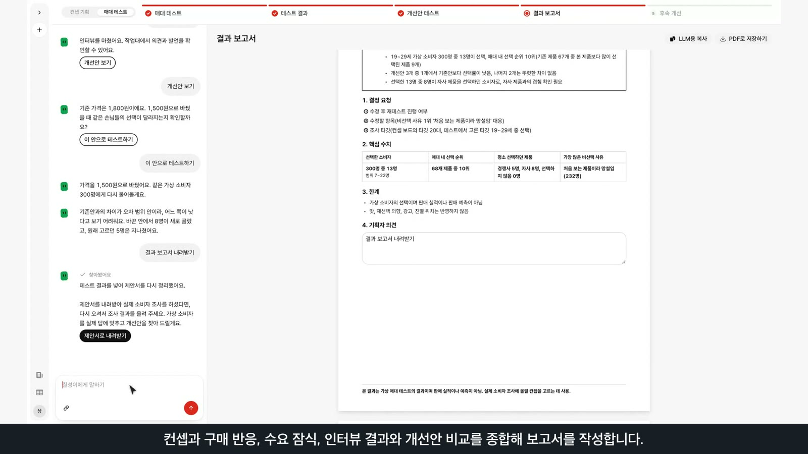
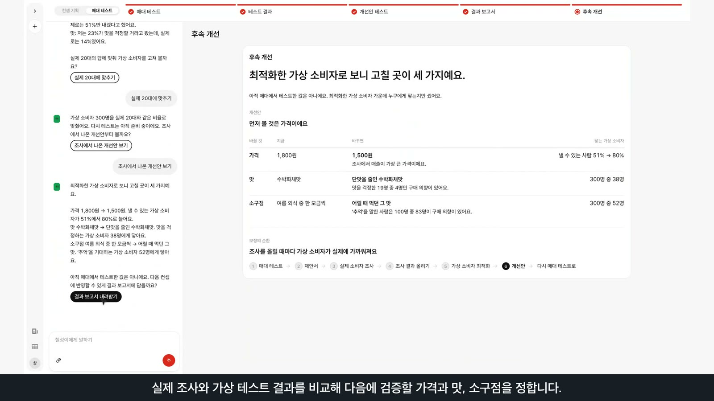
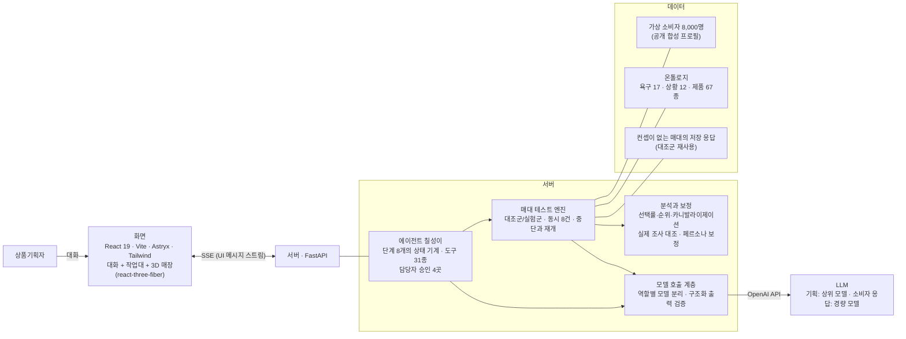
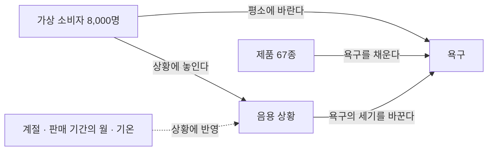

# LOTTE AX CHALLENGE 2026 최우수상 수상작

## AX편의점 · 상품기획 AI 에이전트 칠성이

**신제품 컨셉을 실제 소비자 조사 전에, 가상 편의점 매대에서 AI 가상 소비자 300명에게 먼저 테스트하는 에이전트**

| | |
|---|---|
| 대회 | 롯데 AX 챌린지 2026 본선 (2026-11-24 ~ 11-25, 1박 2일 해커톤) |
| 과제 | 롯데칠성음료 · AI 페르소나 기반 신제품 시장 검증 |
| 참가 | 개인 (기획, 설계, 구현, 발표) |
| 결과 | **최우수상 수상** |
| 자료 | [발표 자료 (PDF)](docs/media/presentation.pdf) · [시연 영상 (3분)](docs/media/demo.mp4) |



> 가상 소비자가 경쟁 제품 67종과 신제품이 함께 놓인 매대에서 하나를 고르는 장면

---

## 1. 프로젝트 개요

### 문제

- 신제품 컨셉 한 건을 검증하는 소비자 조사에 **수 주의 기간과 큰 비용** 소요, 결과가 나쁘면 처음부터 반복
- 비용 부담으로 대부분의 초기 아이디어는 **조사 없이 진행되거나 폐기**
- 조사를 하더라도 "살 것 같다"는 응답과 실제 구매 사이의 간극 존재

### 해결

- 모든 아이디어를 **가상 매대에서 먼저 테스트**하고, 통과한 컨셉에만 실제 조사 예산 투입
- 실제 조사 결과는 다시 가상 소비자 보정에 반영 → **쓸수록 정확해지는 체계**
- 기획자는 에이전트 **칠성이와의 대화만으로** 컨셉 기획부터 매대 테스트, 개선안 검증, 보고서, 사후 보정까지 진행

### 핵심 성과

| 항목 | 값 | 근거 |
|---|---|---|
| 실제 편의점 매출 구성과의 오차 | **78%p → 22%p (72% 감소)** | 음료 5종류의 매출 비중 비교, 온톨로지 반영 전후 |
| 컨셉 1건 테스트 비용 | **약 15달러 → 약 0.4달러 (97% 절감)** | 초안 설계 추정 대비, 대회 API 300명 실측 |
| 300명 테스트 소요 시간 | **3분 33초** | 대회 API 실측, 동시 8건 처리 |
| 신제품 과다 선택 문제 | **100명 중 64명 → 7명** | 가짜 신제품 검사 (기존 제품을 신제품처럼 다시 올림) |
| 규모 | 단계 8개 · 도구 31종 · 담당자 승인 4곳 | 대회 제출 시점 자동 시험 707개 통과 |

---

## 2. 시연

전체 흐름은 [시연 영상 (3분)](docs/media/demo.mp4)에서 확인 가능. 화면의 숫자는 대회 당시 실행한 결과

| 단계 | 화면 | 하는 일 |
|---|---|---|
| 01 아이디어 회의 |  | 한 문장을 입력하면 칠성이가 트렌드, 과거 제품 이력, 외부 리서치를 **먼저 조사해 제시** |
| 03 컨셉 보드 분석 |  | 테스트 전에 수요 추이, 가격 적정성, 유사 과거 사례, 유통 조건을 진단 |
| 04 매대 테스트 |  | 가상 소비자 300명이 가상 편의점에서 경쟁 제품과 신제품을 보고 선택 |
| 05 테스트 결과 |  | 선택률과 매대 순위, 자사 제품에서 옮겨 온 수(카니발라이제이션), 비구매 요인, 음용 상황별 선택률 |
| 06 개선안 테스트 |  | 가상 소비자 인터뷰(1:1, FGI, FGD)로 망설인 이유를 듣고, 개선안을 같은 소비자에게 재검증 |
| 07 결과 보고서 |  | 테스트 결과를 정해진 양식의 보고서로 정리 |
| 08 후속 개선 |  | 실제 조사 결과를 올리면 가상 소비자의 예측과 대조하고, 실제 응답 분포에 맞춰 보정 |

---

## 3. 시스템 아키텍처



### 설계 원칙

- **숫자는 코드가 계산**: 선택률, 순위, 구간, 가상 매출은 규칙 기반으로 산출. 모델은 숫자를 짓지 않음
- **구조화 출력 검증**: 정해진 양식으로만 답을 받고, 어긋나면 다시 질문
- **근거별 출처 표기**: 소비자 기록, 매대, 웹, 에이전트의 제안을 구분해 표시
- **모델 교체 가능**: 모델 호출부를 한 곳에 모아 설정 하나로 교체 (`AX_LLM=openai | codex | cli | fake`)
- **담당자 승인(human-in-the-loop)**: 컨셉 확정, 타깃 확정, 개선안 채택, 보정 적용

### 기술 스택

| 영역 | 사용 기술 |
|---|---|
| 화면 | Vite 8, React 19, TypeScript, Meta Astryx(디자인 시스템), Tailwind 4, react-three-fiber |
| 서버 | Python 3.12, FastAPI, uv, SSE |
| 모델 | OpenAI API (역할별 모델 분리, Responses API) |
| 저장 | 파일 기반 저장(대화, 실행, 대조군 응답) |
| 개발 방식 | 설계와 지시서, 검토는 직접. 구현은 AI 코딩 도구(Claude Code, OpenAI Codex)에 지시서 단위로 위임 |

---

## 4. 핵심 기능

### ① 온톨로지 기반 AI 페르소나

소비자는 제품 스펙이 아니라 **상황과 욕구**로 구매를 결정. 소비자, 욕구, 상황, 제품의 관계를 온톨로지로 정의



- 예: "일하다가 혼자 한 잔" → "정신이 들게 하기" 강화 → 카페인이 많은 음료가 이 욕구를 충족
- 자료: NVIDIA Nemotron-Personas-Korea, 2025 식품소비행태조사, 2024 국민건강영양조사 식품섭취조사
- 검증: 음료 5종류(우유류, 커피, 탄산, 차, 주스)의 금액 비중을 2025년 편의점 매출 비중(aT 식품산업통계정보)과 비교
  - 제품 정보만 제공한 AI: 오차 **78%p** (200회 중 184회는 물·차만 고르거나 구매 포기)
  - 온톨로지를 반영한 AI 페르소나: 오차 **22%p**

### ② 자사 제품 카니발라이제이션 검증

- 사람에게는 같은 질문을 두 번 할 수 없음(첫 응답을 기억). AI 페르소나는 가능
- **같은 가상 소비자**에게 신제품이 없는 매대와 있는 매대를 따로 보여 주고, 신제품을 고른 사람이 원래 무엇을 사던 사람인지 확인
- 결과: 자사 제품에서 옮겨 온 몫을 뺀 **잠식 제외 가상 매출** 산출
- 예시(밀키스 화채, 20대 300명): 13명 선택(4%), 매대 68종 가운데 10위, 13명 중 8명은 자사 제품을 고르던 소비자

### ③ 비용과 품질을 함께 검증한 최적화

| 기법 | 효과 |
|---|---|
| 역할별 모델 분리 | 기획은 상위 모델, 소비자 응답은 경량 모델 → 호출 단가 약 1/20 |
| 대조군 응답 재사용 | 신제품이 없는 매대의 답은 저장해 재사용 → 질문 횟수 절반 |
| 병렬 호출 | 동시 8건 처리 → 300명 테스트 3분 33초 |
| 규칙 기반 산출 | 집계와 보고서 문장은 계산식으로 작성 → 모델 비용 0, 숫자 오류 없음 |
| 조기 결과 · 중단 · 재개 | 진행 중에 먼저 확인, 멈춘 뒤 받은 답은 그대로 사용 |

### ④ 실제 조사로 계속 보정

- 실제 조사 엑셀을 올리면 중복 응답과 불성실 응답을 걸러 낸 뒤 가상 소비자의 예측과 대조
- 가상 소비자의 응답 분포를 실제 응답에 맞춰 보정하고, 보정한 소비자 기준으로 가격·맛·소구점의 개선안 제시
- 보정 기록은 인사이트로 축적되어 다음 테스트로 연결

---

## 5. 트러블슈팅

### 신제품만 고르던 쏠림

- **문제**: 이미 팔리는 제품을 신제품처럼 다시 올리는 가짜 신제품 검사에서, 기준 7명이어야 할 선택이 **100명 중 64명**
- **원인**: 신제품을 따로 설명하고 소감을 함께 물으니, 모델이 "평가해 달라는 대상"으로 받아들여 과다 선택
- **해결**: 신제품을 다른 제품과 같은 모양으로 매대에 올리고, **선택을 먼저 받은 뒤 신제품 평가를 별도 호출로 분리**
- **결과**: 64명 → **7명**(기준과 일치). 호출 수는 약 2배로 늘었지만 품질을 위해 채택

### 제품 정보만으로는 사람처럼 고르지 않는 문제

- **문제**: 제품표만 본 AI는 200회 중 184회 물·차를 고르거나 구매를 포기. 실제 매출 구성과 78%p 차이
- **해결**: 습관, 음용 상황, 욕구를 온톨로지로 연결해 페르소나에 반영
- **결과**: 오차 22%p. 판매 자료로 종류별 합계를 보정하는 단계까지 구성

### 경량 모델 전환 뒤 재현율 하락

- **문제**: 비용을 위해 경량 모델로 바꾸자 같은 답이 다시 나오는 비율이 80.0% → 56.7%
- **해결**: 모델을 되돌리지 않고 입력 구조를 개선(습관과 상황을 구조화해 전달)
- **결과**: 79%까지 회복, 비용 절감은 유지

### 동시 호출 수와 안정성

- **문제**: 동시 16건으로 올리자 간헐적 실패 발생
- **해결**: 8건으로 확정하고, 실패한 호출은 재시도. 중단된 실행은 받은 답을 보존한 채 재개

### 한 명의 실패가 전체를 멈추던 인터뷰

- **문제**: 집단 인터뷰에서 참석자 한 명의 답이 형식 검사에 걸리면 인터뷰 전체가 실패
- **해결**: 걸린 참석자만 제외하고 진행, 재시도 3회

### 제공 자료의 편향

- **문제**: 조사 자료에 중복 응답, 한 점수로만 답한 응답, 제시 순서에 따른 점수 차이가 포함
- **해결**: 정제 단계를 두고, 무엇을 몇 건 걸렀는지 화면과 보고서에 표시

---

## 6. 실행 방법

필요한 것: Python 3.12 이상, [uv](https://docs.astral.sh/uv/), Node 20.19 이상, pnpm 11

```bash
# 서버
cd app/server
uv sync
cp .env.example .env.local      # OPENAI_BASE_URL, OPENAI_API_KEY 입력
AX_LLM=openai uv run uvicorn main:app --port 8787

# 화면 (다른 터미널)
cd app/web
pnpm install
pnpm dev                        # http://localhost:5173
```

- 키는 환경 파일(`.env.local`)로만 읽고 저장소에는 포함하지 않음
- `AX_LLM=fake`로 띄우면 키 없이 가짜 응답기로 화면 흐름 확인 가능

### 이 저장소에 없는 것

공개 저장소에는 아래 자료를 넣지 않았고, 그래서 **매대 테스트와 후속 개선은 그대로 실행되지 않음**. 동작은 시연 영상으로 확인 가능

| 빠진 것 | 이유 | 영향 |
|---|---|---|
| 대회 제공 자료와 거기서 만든 표 (`data/onsite/`) | 대회에서 받은 자료 | 컨셉 보드 분석, 가상 매출, 후속 개선 |
| 가상 소비자의 습관 표 (`data/ours/persona_profiles.csv`) | 조사 응답자 단위 값을 포함. `scripts/assign_persona_needs.py`로 원자료에서 재생성 | 매대 테스트 |
| 트렌드 피드의 기사 사진 | 다른 회사의 사진 | 트렌드 피드의 그림 |

- 문서와 화면 문구에서 대회 설명으로 받은 일부 수치(조사 비용과 기간 등)는 발표 자료와 같이 ●로 가림
- 시험: `cd app/server && AX_LLM=fake uv run pytest -q` → 709개 가운데 644개 통과, 나머지는 위의 빠진 자료가 필요한 시험

## 7. 폴더 구성

```
app/web        화면 (React, TypeScript)
app/server     서버 (FastAPI)
  agent/         에이전트 칠성이: 상태 기계, 도구, 말투
  shelftest/     매대 테스트 엔진: 실행, 집계, 인터뷰
  calibrate/     실제 조사와의 대조, 페르소나 보정
  llm/           모델 호출 계층 (openai, codex, cli, fake)
app/contract   서버와 화면 사이의 약속
data/clean     공개 통계에서 정리한 자료
data/ours      가상 소비자, 매대, 욕구, 상황을 정의한 자료
scripts        자료를 만들고 신뢰도를 잰 스크립트
docs           설계와 측정 기록
```

## 8. 한계

- 가상 소비자의 선택은 **예측 정확도를 주장하지 않음**. 출시 실적과 대조하기 전에는 컨셉끼리의 순서와 방향을 보는 용도
- 맛은 테스트하지 못함. 가상 소비자는 이름, 설명, 가격, 용기로만 판단
- 매출은 선택률을 판매 자료에 건 **가상 매출**이며 실제 실적과 섞어 쓰지 않음
- 보정한 가상 소비자로 매대 테스트를 다시 돌리는 기능은 미구현(보정과 개선안 제시까지)
- 시간과 비용은 대회 API로 한 번 잰 값

## 9. 자료와 라이선스

- 가상 소비자: NVIDIA Nemotron-Personas-Korea
- 소비 성향과 음용 상황: 한국농촌경제연구원 식품소비행태조사, 질병관리청 국민건강영양조사
- 매출 비교: aT 식품산업통계정보(FIS) 편의점 소매 POS
- 입체 매장 모델: Kenney (CC0)
