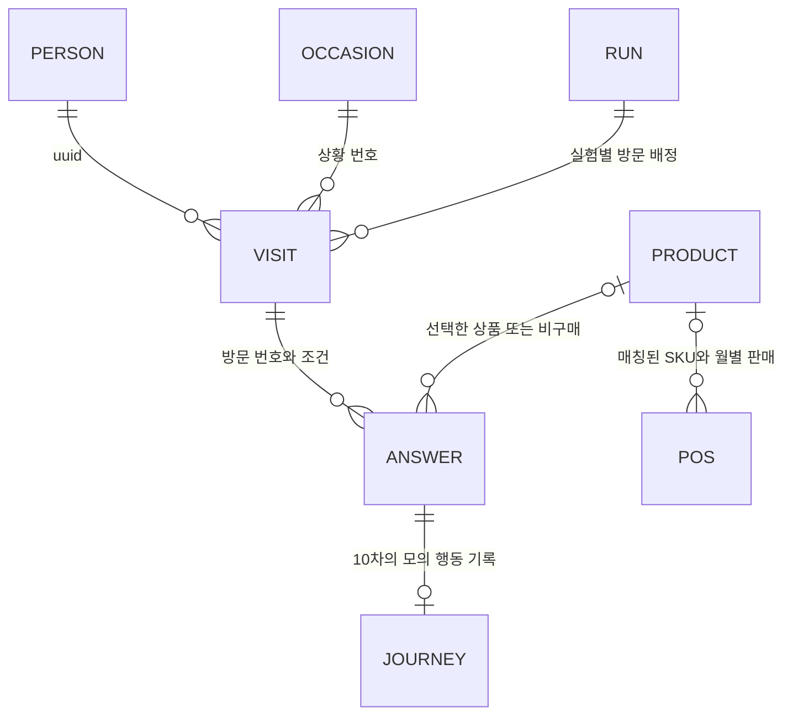
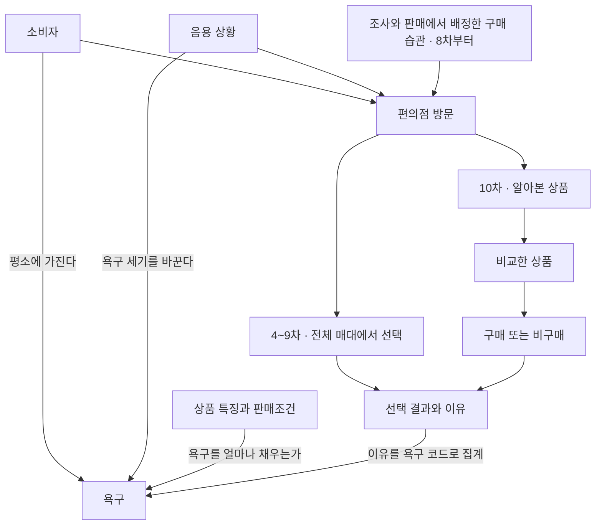
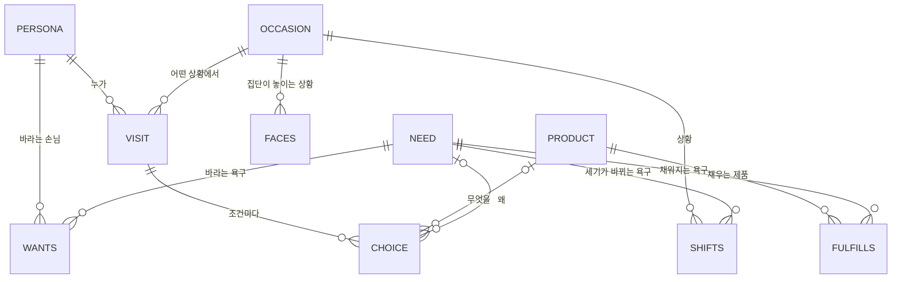

# 데이터 모델 (초안)

손님 자료와 식품 자료를 어떤 구조로 담고 어떻게 잇는지를 정한다. 2026-11-16에 논의 중인 초안이다. 저장 방식(어떤 DB를 쓸지)은 기술 스택을 고를 때 정하고, 여기서는 무엇을 담고 무엇을 잇는지만 다룬다.

관련 문서: 페르소나 자료의 검증은 [simulation.md](simulation.md), 화면에서의 쓰임은 [ux.md](ux.md), 온톨로지를 쓰려는 이유는 [evaluation.md](evaluation.md)의 보완 방향 D.

## 1. 핵심 생각: 욕구가 두 자료를 잇는다

**"욕구"는 이 프로젝트의 중심 개념이다. 설계뿐 아니라 화면, 발표 자료, 보고서에서도 앞에 내세운다(2026-11-16 참가자 결정).**

손님 자료(누가 어떤 사람인가)와 식품 자료(어떤 제품이 어떤 특징을 가졌나)는 원래 서로 닿는 곳이 없다. 가운데에 **욕구**라는 공통 어휘를 두면 이어진다.

```
손님 ──가진다──▶ 욕구 ◀──채워준다── 제품 특징 ──근거──▶ 근거 자료
32세 사무직      당을 줄이고 싶다      제로 슈거            포장 문구
```

참가자가 말한 "속성을 나열하는 대신 관계를 따라 근거를 찾는다"의 구체적인 모습이다. "상품명 바나나우유, 가격 1,800원, 색깔 노란색"이라는 나열에는 왜 고르는지가 없다. "달콤한 것이 당긴다 → 바나나맛 → 포장 문구"라는 길에는 있다.

### 이 연결로 하는 일 세 가지

1. **말이 맞는지 검사한다.** 가상 손님이 "제로라서 골랐어요"라고 했는데 그 제품에 제로 특징이 없으면 모순이다.
2. **이유를 모아 센다.** 손님마다 표현이 달라도 같은 욕구로 묶이므로 집계가 흔들리지 않는다. 모델을 바꿔도 일정하다.
3. **빈자리를 찾는다.** 가진 손님은 많은데 채워주는 제품이 적은 욕구의 조합이 매대의 빈자리다. 칠성이가 기획안을 먼저 제안할 때의 근거가 된다.

## 2. 욕구의 품질

욕구를 엉성하게 정하면 전체가 무너진다. "당이 필요하다"는 욕구는 설탕물도 콜라도 채워준다. 이런 욕구로는 제품을 가르지 못하고, 빈자리를 찾아도 쓸모없는 제안이 나온다.

### 사람은 욕구 하나로 고르지 않는다

한 번의 구매에는 여러 욕구가 함께 있다. 제품은 그 묶음을 얼마나 채우는지가 저마다 다르다.

| 욕구 | 설탕물 | 콜라 | 제로 콜라 |
|---|---|---|---|
| 당을 채우고 싶다 | 채움 | 채움 | 못 채움 |
| 톡 쏘는 시원함 | 못 채움 | 채움 | 채움 |
| 익숙하고 믿을 만한 맛 | 못 채움 | 채움 | 채움 |
| 살찔 걱정 덜기 | 못 채움 | 못 채움 | 채움 |
| 들고 다니며 마시기 | 못 채움 | 채움 | 채움 |

설탕물과 콜라가 같아 보이는 것은 욕구를 하나만 봤기 때문이다. 묶음으로 보면 갈린다. 그래서 다음과 같이 정한다.

- **채워준다는 연결에 정도를 둔다.** 채움과 못 채움 둘로만 나누지 않고, 잘 채움, 조금 채움, 못 채움, 오히려 거스름으로 나눈다. 당이 든 콜라는 "살찔 걱정 덜기"를 거스른다.
- **빈자리는 욕구 하나가 아니라 욕구의 조합에서 찾는다.** "살찔 걱정 덜기"와 "많이 마시기"를 함께 채우는 제품이 한 종뿐이라는 식이다.

### 좋은 욕구의 조건

욕구 목록에 넣으려면 아래를 모두 통과해야 한다.

| 조건 | 뜻 | 탈락하는 예 |
|---|---|---|
| 제품을 가른다 | 매대의 제품 중 일부만 채워야 한다. 모든 제품이 채우는 욕구는 고르는 이유가 되지 못한다. | "갈증 해소", "마실 수 있음" |
| 매대에서 확인된다 | 그 욕구를 채우는지를 매대에서 보이는 특징으로 판단할 수 있어야 한다. | "몸에 좋음"(무엇을 보고 판단할지 없음) |
| 손님에게서 근거가 나온다 | 손님 서술이나 조사 자료에서 실제로 그런 바람이 보여야 한다. 우리가 지어낸 욕구는 넣지 않는다. | 자료 어디에도 없는 바람 |
| 서로 겹치지 않는다 | 같은 것을 다른 말로 두 번 넣지 않는다. | "당 줄이기"와 "설탕 피하기" |
| 넓이가 알맞다 | 너무 넓으면 가르지 못하고, 너무 좁으면 제품 하나의 설명이 된다. | "맛있음"(너무 넓음), "라임향 355ml"(너무 좁음) |

"제품을 가른다"는 자료로 기계적으로 검사할 수 있다. 매대의 제품 전부가 채우거나 하나도 채우지 못하는 욕구는 자동으로 걸러낸다.

### 욕구는 두 층으로 쓴다

특징에서 곧바로 큰 바람으로 가지 않고, 가운데에 얻는 것을 둔다.

```
특징(무엇이 들었나) → 얻는 것(그래서 뭐가 좋은가) → 바라는 것(왜 그것을 바라는가)
제로 슈거           → 당과 열량 걱정이 없다        → 살찔 걱정 없이 마시고 싶다
500ml 페트          → 뚜껑을 닫아 두고 나눠 마신다   → 오후 내내 옆에 두고 마시고 싶다
```

마케팅 조사에서 쓰는 수단-목적 사슬과 같은 생각이다(속성, 결과, 가치로 이어지는 사슬). 기억에 의존한 내용이라 발표에서 인용하려면 출처를 확인한다.

### 빈자리는 기회가 아니라 가설이다

빈자리라고 해서 다 기회는 아니다. 채워지지 않은 데에는 이유가 있을 수 있다(바라는 사람이 적다, 만들기 어렵다, 값이 맞지 않는다).

- 칠성이는 빈자리를 "기회"가 아니라 "확인해 볼 만한 가설"로 내놓는다.
- 빈자리의 크기를 함께 말한다: 그 욕구 조합을 가진 손님이 몇 명인지, 지금 그것을 채우는 제품이 몇 개인지.
- 그 가설을 가상 매대에서 실험해 확인하는 것이 이 도구의 쓰임이다. 빈자리 찾기와 가상 실험이 한 흐름으로 이어진다.

## 3. 같은 사람도 날마다 다르다

밀크티를 즐겨 마시는 사람도 오늘따라 커피가 당길 수 있다. 사람의 선택은 평소 성향만으로 정해지지 않는다. 세 가지가 겹친다.

| 층 | 뜻 | 다루는 방법 |
|---|---|---|
| 평소 성향 | 그 사람이 대체로 바라는 것. 잘 바뀌지 않는다. | "손님의 욕구"에 세기로 담는다. |
| 오늘의 상황 | 지금 어떤 때인가. 시간대, 방금 한 일, 함께 있는 사람, 날씨, 이미 마신 것. | "상황"을 따로 두고, 상황이 욕구의 세기를 올리고 내리게 한다. |
| 변덕 | 이유 없이 오늘따라 다른 것이 당기는 것. | 이유를 모델링하지 않는다. 같은 조건을 반복했을 때의 흔들림으로 크기만 잰다. |

### 상황을 따로 둔다

- 방문한 달과 그달의 월평균 기온도 상황의 속성이다. 제공 기온 표와 편의점 월별 판매수량을 사용하며, 새 차수에서는 같은 손님의 대조 매대와 컨셉 매대에 같은 달을 배정한다.

- 상황의 예(확정 아님): 출근길, 점심을 먹은 뒤, 오후에 졸릴 때, 운동한 뒤, 야근 중, 집에 가는 길, 식사에 곁들일 때.
- 상황은 욕구의 세기를 바꾼다. "오후에 졸릴 때"는 "정신이 들게 하기"를 올리고, "이미 커피를 두 잔 마셨다"는 "카페인 피하기"를 올린다.
- **실험의 단위를 손님이 아니라 방문으로 둔다.** 방문은 손님 한 명과 상황 하나의 짝이다. 같은 손님이 다른 상황으로 여러 번 방문할 수 있다. 300번의 방문은 손님 100명이 세 가지 상황에서 온 것일 수 있다.
- 이렇게 하면 "누가 고르나"와 함께 "어떤 때 고르나"를 볼 수 있다. 기획자에게는 후자가 더 쓸모 있을 때가 많다("이 제품은 오후 야근 상황에서 강해요").
- 싫증도 상황으로 다룬다. "요즘 늘 같은 것만 마셨다"는 상황은 "새로운 맛"을 올린다.

### 풀지 못하는 것 (한계)

숨기지 않고 산출물에 적는다.

- **한 사람의 오늘 선택은 맞추지 못한다.** 이 도구는 개인을 예측하지 않는다. 여러 손님과 여러 상황에 걸친 분포를 본다.
- **이유 없는 변덕은 이유를 설명하지 못한다.** 크기만 잰다. 변덕의 크기가 크면 두 기획안의 차이를 구별하는 데 더 많은 방문이 필요하다([simulation.md](simulation.md) 1절의 엇갈림 비율이 이것이다).
- **상황이 얼마나 자주 일어나는지는 자료가 필요하다.** 편의점에 오는 사람 중 오후 졸릴 때 오는 사람이 몇 할인지 모르면, 상황의 비중은 가정이 된다. 현장 자료나 조사 자료로 채워야 한다.
- **실제 구매 이력이 없다.** "지난주에 무엇을 샀나"는 가상 손님에게 없다. 싫증과 습관은 서술에서 짐작한 수준이다.
- **유행은 다루지 못한다.** 갑자기 뜨는 맛이나 화제는 과거 자료에 없다.

## 4. 무엇을 담는가

### 식품 자료

| 이름 | 한 건이 뜻하는 것 | 주요 항목 |
|---|---|---|
| 제품 | 판매처와 무관한 제품 하나 | 회사(우리 또는 다른 회사), 브랜드, 이름, 카테고리, 용량, 용기, 상태(판매 중 또는 기획안) |
| 판매조건 | 어느 판매처에서 언제 얼마에 파는가 | 판매처, 가격, 행사(없음, 1+1, 2+1), 행사 적용 수량, 확인한 날 |
| 특징 | 제품의 특징 한 가지 | 종류(맛, 당, 열량, 카페인, 탄산 세기, 용량 등), 값, 매대에서 보이는가 |
| 근거 자료 | 값이 어디서 왔는가 | 유형(공식 정보, 홍보 문구, 후기, 조사 자료, 가정), 출처, 수집일, 원문 발췌 |

- 기획안도 "제품"에 담는다. 상태만 다르다.
- 가격과 행사를 "판매조건"으로 뗀 이유: 같은 제품이 판매처와 시기마다 값이 다르다. 1개 구매 실험에 2+1 단가가 붙는 실수를 막는다.
- 특징의 "매대에서 보이는가": 가상 손님에게는 매대에서 보이는 것만 보여준다는 원칙을 자료에서 지키기 위한 표시다.
- 기획안의 특징은 근거 유형이 "가정"이다. 출시 전 제품의 후기는 만들지 않는다.

### 손님 자료

| 이름 | 한 건이 뜻하는 것 | 주요 항목 |
|---|---|---|
| 손님 | 가상 소비자 한 명 | 성별, 나이, 지역, 직업, 학력, 혼인 상태, 가구 형태, 생활 배경 서술, 음식 관련 서술 |
| 손님의 욕구 | 그 손님이 평소에 어떤 욕구를 얼마나 가졌는가 | 욕구, 세기, 근거 자료 |

바탕은 NVIDIA Nemotron-Personas-Korea다. 2026-11-16에 데이터셋 카드에서 확인한 사실은 이렇다.

- 100만 건, 컬럼 26개, CC BY 4.0, 약 2GB.
- 인구통계 컬럼: `sex`, `age`(19~99), `marital_status`, `military_status`, `family_type`(39종), `housing_type`, `education_level`, `bachelors_field`, `occupation`, `district`(252개 시군구), `province`(17개 시도), `country`.
- 서술 컬럼: `persona`, `professional_persona`, `sports_persona`, `arts_persona`, `travel_persona`, `culinary_persona`, `family_persona`, `cultural_background`, `skills_and_expertise`, `hobbies_and_interests`, `career_goals_and_ambitions` 등.
- **소득 컬럼은 없다.** 예산은 가정으로 둔다.
- **음식 관련 서술(`culinary_persona`)이 있다.** 외식·배달 빈도, 선호 음식, 브랜드 이름이 문장으로 들어 있다. 카드 요약에 따르면 한국농촌경제연구원의 2024 식품소비행태조사가 바탕 자료의 하나다. 다만 문장은 모델이 생성한 것이다.
- **술 이야기는 많고 술이 아닌 음료 이야기는 거의 없다(2026-11-16 전체 100만 건에서 확인).** 주종 이름이 하나라도 나오는 손님이 23%다("소주" 11.6%, "맥주" 8.3%). 반면 "탄산" 0.2%, "콜라" 0.4%, "커피" 2.8%다. 생활 습관의 단서는 넉넉하다("운동" 56%, "건강" 37%, "혈당" 10%). 롯데칠성은 주류도 팔므로 주류는 범위 안이다. 어느 카테고리로 할지는 아직 정하지 않았다. 상세는 [data-sources.md](data-sources.md)의 "아직 끝나지 않은 결정".

"손님의 욕구"는 세 가지 길로 채우고, 어느 길로 채웠는지를 근거 자료에 남긴다.

| 길 | 방법 | 근거 유형 |
|---|---|---|
| 서술에서 뽑기 | 생활 배경 서술에서 단서(혈당 관리, 운동, 음주 등)를 찾고 거기서 욕구와 세기를 짐작한다. 서술에 적힌 것과 짐작한 것을 나눠 적는다. | 조사 자료(합성 서술)와 짐작 |
| 조사 분포에서 입히기 | 실제 조사에서 같은 연령·성별·가구 형태 집단의 분포를 구해 입힌다. | 조사 자료(실제 조사) |
| 가정 | 위 둘로 알 수 없는 것. | 가정 |

### 둘을 잇는 것

| 이름 | 한 건이 뜻하는 것 | 주요 항목 |
|---|---|---|
| 욕구 | 음료를 고를 때 사람이 바라는 것 한 가지 | 이름, 풀어 쓴 설명, 층(얻는 것 또는 바라는 것), 제품을 가르는가 |
| 채워준다 | 어떤 특징이나 판매조건이 어떤 욕구를 얼마나 채우는가 | 특징의 종류와 값(또는 판매조건), 욕구, 정도(잘 채움, 조금 채움, 못 채움, 거스름) |
| 상황 | 어떤 때에 사는가 | 이름, 풀어 쓴 설명, 비중과 그 근거 |
| 상황이 바꾸는 욕구 | 그 상황에서 어떤 욕구가 강해지고 약해지는가 | 상황, 욕구, 방향과 크기 |

- 욕구는 카테고리마다 10~15개의 정해진 목록으로 둔다. 가상 손님이 고른 이유도 이 목록에서 고르게 한다(여러 개 고를 수 있다).
- 목록에 없는 이유는 "기타"로 받고 문장을 남긴다. "기타"가 많이 쌓이면 목록을 고친다.

### 욕구 목록 초안 (2026-11-17)

목록은 `data/ours/needs.csv`에 있다(번호, 욕구, 설명, 범위, 위층의 바라는 것, 매대에서 확인되는 것, 손님 쪽 근거, 품질 조건 판정). 20개를 쓰고 품질 조건으로 걸러 17개를 남겼다. 음료 매대에는 공통 9개와 음료 3개, 주류 매대에는 공통 9개와 주류 5개가 쓰인다.

| 바라는 것(위층) | 욕구(얻는 것) | 범위 |
|---|---|---|
| 안심 | 익숙한 것 고르기 | 공통 |
| 돈 아끼기 | 돈을 적게 쓰기, 덤으로 이득 보기, 양에 비해 싼 것 | 공통 |
| 건강 지키기 | 당과 열량 걱정 덜기, 감미료와 첨가물 피하기 | 공통 |
| | 달지 않게 깔끔하게 마시기(갈증 풀기), 몸에 좋은 성분 챙기기 | 음료 |
| | 가볍게 마시기 | 주류 |
| 즐거움 | 맛이 확실한 것 즐기기, 새로운 것 맛보기, 음식과 어울리게 마시기 | 공통 |
| | 진하게 마시기, 조금 특별하게 마시기 | 주류 |
| 기운 차리기 | 정신이 들게 하기 | 음료 |
| 함께 어울리기 | 여럿이 나눠 마시기 | 주류 |
| 편하게 마시기 | 혼자 한 캔으로 끝내기 | 주류 |

- **공통 욕구가 9개다.** 음료와 주류가 같은 어휘를 쓴다는 뜻이고, "욕구는 카테고리를 가로지른다"는 가설을 시험할 수 있는 구조다. "당과 열량 걱정 덜기"는 제로 탄산과 제로슈거 소주에 함께 걸린다.
- **서로 거스르는 짝이 있다.** "당과 열량 걱정 덜기"와 "감미료와 첨가물 피하기"(제로 제품은 앞을 채우고 뒤를 거스른다), "당과 열량 걱정 덜기"와 "맛이 확실한 것 즐기기", "가볍게 마시기"와 "진하게 마시기". 이런 짝이 답의 모순 검사와 빈자리 찾기의 재료다.
- **근거**: 17개 가운데 14개는 조사 자료에 수치가 있다. "덤으로 이득 보기"는 매대 자료만 있고 손님 쪽 세기는 가정이다.
- **보류한 것 3개**: "카페인 피하기"(근거 없음, 해당 제품 0.5%), "속 편하게 마시기"(근거 약함, 겹침), "들고 다니며 마시기"(손님 쪽 근거 없음). 현장 자료나 가상 손님의 "기타" 이유에서 자주 나오면 되살린다.
- **이름을 고친 것**: "갈증 풀기"는 모든 음료가 채워 제품을 가르지 못한다(2절의 탈락 예). "달지 않게 깔끔하게 마시기(갈증 풀기)"로 좁혔다.
- **아직 안 한 것**: "제품을 가른다"의 기계적 검사는 채워준다 연결을 만든 뒤에 한다. 지금 비율은 상품명의 낱말로 센 어림값이다. 신상품 꼬리표는 수집하지 못했다.

### 매대와 채워준다 연결 초안 (2026-11-17)

[scripts/build_shelves.py](../scripts/build_shelves.py)가 세 파일을 만든다. 제품 선택, 특징, 규칙이 모두 이 스크립트 안에 적혀 있고 고치면 표가 다시 만들어진다.

| 파일 | 내용 |
|---|---|
| `data/ours/shelf_products.csv` | 매대 제품 75개(음료 43, 주류 32). 우리 제품은 음료 18, 주류 12. 가격과 행사의 근거, 특징, 확인한 날 |
| `data/ours/fulfills.csv` | 제품마다 욕구를 얼마나 채우는지(잘 채움, 조금 채움, 못 채움, 거스름)와 적용한 규칙. 약 960줄 |
| `data/ours/needs_coverage.csv` | 욕구마다 정도별 제품 수와 "제품을 가르는가" 판정 |

- **제품 선택**: 종류마다 우리 제품과 다른 회사 제품을 함께 넣었다. 음료는 탄산 12, 커피 8, 차 5, 에너지 4, 이온 4, 주스 4, 우유·단백 3, 물·탄산수 3. 주류는 맥주 14, 소주 6, 하이볼류 6, 논알콜 3, 막걸리 1, 청주·와인 2. 사람이 고른 것이다.
- **판매조건**: 음료 43개 가운데 24개가 행사 중이다(1+1 12, 2+1 10, 할인 2). 주류는 28개가 세븐일레븐 할인행사 목록에서 왔고 4개는 한국소비자원의 기본 가격이다.
- **특징은 가정이다.** 당, 카페인, 탄산, 도수 구간, 알려진 브랜드인지는 상품명과 일반 지식으로 적었다. 식품영양성분 공공 자료와 제조사 정보로 바꿔야 한다.
- **채워주는 정도는 규칙으로 정한다.** 예: "덤으로 이득 보기"는 1+1이면 잘 채움, 2+1이나 할인이면 조금 채움. "당과 열량 걱정 덜기"는 제로나 무가당이면 잘 채움, 당이 든 제품이면 거스름. 규칙마다 글로 남긴다.
- **기계적 검사 결과**: 음료 12개 욕구 가운데 11개, 주류 14개 욕구 모두가 제품을 가른다. 음료의 "새로운 것 맛보기"만 걸렸다(신상품 표시를 수집하지 못해 채우는 제품이 없음).
- **빈자리 찾기를 돌려 봤다.** 두 욕구를 함께 잘 채우는 제품이 1개 이하인 조합이 음료 27개, 주류 40개 나왔다. 여기서 배운 것:
  - 대부분은 빈자리가 아니라 **서로 거스르는 짝**이다("가볍게 마시기"와 "진하게 마시기", "당과 열량 걱정 덜기"와 "맛이 확실한 것 즐기기"). 욕구 목록에 거스르는 짝을 표시해 빈자리 후보에서 빼야 한다.
  - 뜻이 있어 보이는 조합: 음료의 "정신이 들게 하기 + 달지 않게 깔끔하게 마시기"(카페인이 있는 무가당 음료), "정신이 들게 하기 + 몸에 좋은 성분 챙기기", "몸에 좋은 성분 챙기기 + 당과 열량 걱정 덜기". 주류의 "가볍게 마시기 + 조금 특별하게 마시기"(무알콜 하이볼류), "가볍게 마시기 + 맛이 확실한 것 즐기기".
  - **이 결과는 우리가 고른 75개 기준이다.** 매대에 올리지 않은 제품이 그 자리를 채우고 있을 수 있다(예: CU 목록에는 단백질 커피가 있다). 빈자리를 말하기 전에 전체 후보 목록에서 다시 확인해야 한다.
- **남은 문제**: 주류 낱개의 "할인행사"가 무슨 할인인지(4캔 묶음가인지) 확인하지 않았다. 지금은 모두 "조금 채움"이다.

### 손님의 욕구 초안 (2026-11-17)

[scripts/assign_persona_needs.py](../scripts/assign_persona_needs.py)가 손님 8,000명에게 2025 식품소비행태조사 성인 응답자 한 명의 답을 통째로 입히고, 그 답에서 욕구 17개의 세기(0 없음, 1 약함, 2 보통, 3 셈)를 정한다.

| 파일 | 내용 | 저장소 |
|---|---|---|
| `data/ours/persona_needs.csv` | 손님마다 욕구 17개의 세기와 술을 마시는지 | 올린다 |
| `data/ours/persona_needs_report.md` | 욕구별 세기 분포, 연령대별 차이, 근거로 쓴 문항 | 올린다 |
| `data/ours/persona_profiles.csv` | 손님마다 입힌 응답자의 답(좋아하는 음료 1~3순위, 음주 빈도, 좋아하는 술, 제로 음료·주류 빈도, 소득 구간, 다이어트·건강 관심, 운동) | 올리지 않는다(응답자 단위 값). 스크립트로 다시 만든다 |

- **입히는 방법**: 성별·연령대가 같은 응답자 가운데 한 명을 가중치에 비례해 고른다. 고르는 순서는 손님 uuid로 정해져 다시 돌려도 같다. 8,000명에게 응답자 3,717명이 쓰였고(가장 많이 쓰인 응답자는 13번), 처음 3,000명에게 붙은 응답자는 패널을 늘린 뒤에도 그대로다(2026-11-24, 매대 테스트에서 한 칸에 탐색 40명과 타깃 300명을 겹치지 않게 뽑으려고 3,000명에서 늘렸다).
- **서술과 어긋나지 않게 고쳤다.** 처음에는 서술에 술 이야기가 나오는 손님 525명 가운데 90명(17%)에게 술을 마시지 않는 응답자가 붙었다. 서술에 술이 나오면 술을 마시는 응답자 가운데서만 고르게 바꿨다. 그 대가로 술을 마시는 손님이 75.7%가 되어 조사 전체(72.2%)보다 3.5%p 높다(8,000명 기준).
- **욕구에 쓴 문항**: 식생활 의견 5점 척도(가격을 비교해 산다, 가격 대비 품질을 따진다, 가격보다 맛, 새로운 음식을 좋아한다, 다양한 맛을 원한다), 다이어트 관심, 건강 관심과 투자, 규칙적 운동, 소득, 좋아하는 음료와 술, 음주 빈도, 제로식품 빈도와 이유, 저녁을 누구와 먹는가.
- **술을 마시지 않는 손님**(1,948명)은 주류 욕구 5개가 모두 0이다. 주류 매대의 방문에서 뺀다.
- **연령대별 차이가 조사와 같은 방향으로 나온다(세기 2 이상인 손님의 비율).** 당과 열량 걱정 덜기: 20대 83%, 70대 이상 34%. 감미료와 첨가물 피하기: 20대 28%, 70대 이상 66%. 음식과 어울리게 마시기: 20대 58%, 70대 이상 27%. 조금 특별하게 마시기: 30대 58%, 70대 이상 21%.

**알고 있는 문제 (검증 때 맞춘다)**

- **대리 문항이 많다.** 17개 가운데 8개는 조사가 그 욕구를 직접 묻지 않아 비슷한 문항으로 대신했다(덤으로 이득 보기, 양에 비해 싼 것, 익숙한 것 고르기, 음식과 어울리게 마시기, 정신이 들게 하기, 진하게 마시기, 여럿이 나눠 마시기, 혼자 한 캔으로 끝내기).
- **한쪽으로 몰린 욕구가 있다.** "맛이 확실한 것 즐기기"는 손님의 93%가 보통 이상이라 사람을 가르지 못한다. 가격 욕구 셋도 80% 안팎이다. 5점 척도에 후하게 답하는 경향 때문으로 보인다. 손님 안에서의 순위로 바꾸거나 기준을 올리는 것을 검증 때 정한다.
- **"달지 않게 깔끔하게 마시기(갈증 풀기)"는 0이 57%다.** 좋아하는 음료 3순위 안에 차나 탄산수가 있어야 세기가 붙는 규칙이라 그렇다. 조사 보기에 생수가 없다.
- 손님의 직업, 지역, 술 이외의 서술과 응답자의 답은 맞추지 않았다.

### 상황과 상황이 바꾸는 욕구 초안 (2026-11-17)

[scripts/build_occasions.py](../scripts/build_occasions.py)가 2024 국민건강영양조사의 마신 기록(19세 이상, 음료·유제품 10,371건과 주류 1,215건)에서 네 파일을 만든다. 상황의 이름과 경계는 우리가 정했고, 비중과 크기는 기록에서 나온다.

| 파일 | 내용 |
|---|---|
| `data/ours/occasions.csv` | 상황 12개(음료 8, 주류 4)의 이름, 정의, 전체 비중 |
| `data/ours/occasion_weights.csv` | 성별·연령대마다 각 상황의 비중. 손님에게 상황을 배정하는 확률이다 |
| `data/ours/occasion_drink_mix.csv` | 상황마다 실제로 마신 음료 종류의 비율. 검증의 기준값이다 |
| `data/ours/occasion_needs.csv` | 상황이 욕구를 얼마나 올리고 내리는가(-2 ~ +2), 근거 종류(자료, 정의, 가정) |

**상황은 기록에 있는 것으로 정의한다**: 끼니인지 간식 자리인지, 장소(집, 일터, 밖), 혼자인지, 오전인지. "졸릴 때" 같은 마음 상태는 쓰지 않는다.

| 매대 | 상황 | 비중 | 많이 마신 것 | 가장 크게 바뀌는 욕구 |
|---|---|---|---|---|
| 음료 | 일하다가 혼자 한 잔 | 16.1% | 커피 80% | 정신이 들게 하기 +1.6 |
| 음료 | 일터에서 함께 쉬면서 | 7.0% | 커피 80% | 정신이 들게 하기 +1.5 |
| 음료 | 집에서 혼자 오전에 | 8.1% | 커피 75%, 우유류 14% | 정신이 들게 하기 +1.3 |
| 음료 | 집에서 혼자 낮이나 저녁에 | 15.1% | 커피 53%, 우유류 22% | 몸에 좋은 성분 챙기기 +0.4 |
| 음료 | 집에서 가족과 간식 자리 | 7.6% | 커피 64%, 우유류 14% | 정신이 들게 하기 +0.6 |
| 음료 | 밖에서 쉬거나 사람을 만나며 | 12.1% | 커피(커피만) 57% | 정신이 들게 하기 +1.1, 당과 열량 걱정 덜기 +0.9 |
| 음료 | 밖에서 식사와 함께 | 13.9% | 탄산 33%, 과일·채소음료 20% | 정신이 들게 하기 -2.0, 맛이 확실한 것 즐기기 +1.7, 음식과 어울리게 마시기 +1.6 |
| 음료 | 집에서 식사와 함께 | 20.1% | 우유류 31%, 탄산 17% | 정신이 들게 하기 -1.7, 몸에 좋은 성분 챙기기 +1.1 |
| 주류 | 밖에서 사람들과 식사하며 | 42.5% | 소주 55%, 맥주 33% | 진하게 마시기 +1.5 |
| 주류 | 집에서 가족과 식사하며 | 24.0% | 소주 46%, 맥주 37% | (평균에 가깝다) |
| 주류 | 식사와 따로 사람들과 한잔 | 16.0% | 맥주 48%, 소주 30% | 진하게 마시기 -2.0, 조금 특별하게 마시기 +0.7 |
| 주류 | 혼자 마실 때 | 17.5% | 맥주 46%, 소주 30% | 진하게 마시기 -2.0, 조금 특별하게 마시기 +0.8 |

- **크기를 구하는 방법**: 어떤 상황에서 어떤 종류를 평소보다 많이 마셨는지를 보고, 그 종류가 채워주는 욕구를 그만큼 올린다. 종류와 욕구의 연결(커피는 "정신이 들게 하기", 탄산은 "음식과 어울리게 마시기" 등)은 우리의 판단이고 스크립트의 `TYPE_NEEDS`에 있다. 매대 안에서 가장 큰 값이 2가 되게 맞췄다.
- **반쪽 검증**: 응답자를 반으로 나눠 따로 구한 값의 상관이 음료 0.99, 주류 0.88이다. 크기 0.5 이상인 38개(음료 28, 주류 10)는 두 반쪽에서 방향이 모두 같다. 우연히 나온 값이 아니다.
- **근거 종류를 나눠 적는다.** "자료"는 기록에서 구한 것, "정의"는 상황의 정의에서 바로 나오는 것(함께 마시는 자리이면 "여럿이 나눠 마시기"가 오른다), "가정"은 기록으로 구할 수 없어 우리가 넣은 것이다. 가정은 "덤으로 이득 보기" 하나뿐이다(혼자 밖에서는 내리고, 집이나 함께 있는 자리에서는 올린다).
- **집단별 비중**: 성별·연령대 12개 집단마다 구했다. 주류의 70대 이상 여자만 마신 자리가 40건에 못 미쳐 연령대 전체 값으로 대신했다.

**한계**

- 마신 자리이지 산 자리가 아니다. "편의점에서 사서 그 자리로 가져간다"는 연결은 가정이다. 편의점에서 사지 않는 자리(음식점에서 주문한 소주, 카페에서 산 커피)가 섞여 있다.
- 기록에 종류가 8~11가지뿐이라, 종류에 걸리지 않는 욕구(돈을 적게 쓰기, 익숙한 것 고르기, 새로운 것 맛보기)는 상황이 바꾸지 않는 것으로 둔다.
- 마시기 직전에 한 일(운동, 야근)과 날씨는 없다.
- 조사 요일이 평일에 몰려 있다. 주말의 상황 비중은 다를 수 있다.
- 종류와 욕구의 연결이 틀리면 크기도 틀린다. 검증 때 가상 손님의 선택이 `occasion_drink_mix.csv`의 비율을 재현하는지로 확인한다.

### 가격과 행사를 욕구로 다룬다 (2026-11-17 결정, 세부는 초안)

참가자 결정: **1+1 같은 행사는 욕구로 잡는다.** 가격을 계산해서 넣지 않고, "행사라서 고른다"를 이유로 셀 수 있게 한다. 근거: 편의점 음료의 절반이 행사 중이다([data-sources.md](data-sources.md) 4절).

가격에 대한 욕구는 하나가 아니다. 하나로 뭉치면 싼 제품과 행사 제품을 가르지 못하므로(2절의 "제품을 가른다", "겹치지 않는다") 나눠 본다. 아래는 초안이고 욕구 목록을 만들 때 확정한다.

| 욕구(가칭) | 뜻 | 채워주는 것 | 매대에서 보이는가 |
|---|---|---|---|
| 돈을 적게 쓰기 | 지금 내는 돈이 적은 것을 바란다. | 정가가 낮은 것 | 가격표 |
| 덤으로 이득 보기 | 같은 돈에 하나 더 받는 것, 이득 본 느낌을 바란다. | 1+1(잘 채움), 2+1(조금 채움), 할인(조금 채움), 행사 없음(못 채움) | 행사 꼬리표 |
| 양에 비해 싼 것 | 용량에 비해 값이 싼 것을 바란다. | 용량당 가격이 낮은 것, 묶음 | 가격표와 용량 |

- **행사는 판매조건에서 욕구로 잇는다.** "채워준다"는 특징뿐 아니라 판매조건도 받는다(위 표의 정의). 같은 제품이 행사가 있을 때와 없을 때 채워주는 정도가 달라진다.
- **행사는 거스를 수도 있다.** 하나만 필요한 사람에게 1+1은 짐이 된다. 혼자이고 이동 중인 상황에서는 덤의 값어치가 떨어지고, 집에 가는 길이거나 함께 마실 사람이 있으면 올라간다. 이것을 "상황이 바꾸는 욕구"로 다룬다. 동반과 장소는 국민건강영양조사 기록에 있다.
- **가상 손님에게는 매대에서 보이는 그대로 보여준다.** "2,500원, 1+1"이라고만 보여주고 1개당 단가로 바꿔 주지 않는다. 한 번의 구매를 한 건의 선택으로 센다(1+1을 고르면 두 개를 받는 구매 한 건).
- **손님 쪽 세기의 근거**: 가공식품 소비자태도조사에서 구입 시 가격을 먼저 확인한다는 응답이 음료 16.6%, 주류 26.3%다. 식품소비행태조사 응답자의 소득과 가격 관련 문항을 손님에게 입힌다(문항은 확인해야 한다).
- **검증**: 같은 제품에 행사만 붙였다 뗀 두 매대를 비교한다(방향성 검사). 행사를 붙이면 선택이 늘어야 하고, "덤으로 이득 보기"가 센 손님에게서 더 늘어야 한다. 늘어난 선택이 다른 회사 제품에서 왔는지 우리 제품에서 왔는지도 본다(자기잠식).
- **쓰임**: 기획자에게 "출시 때 1+1을 붙이면 어떻게 되나요?"에 답할 수 있다. 칠성이가 변형안 실험으로 제안할 수 있는 항목이다.
- **한계**: 행사가 실제로 판매를 얼마나 올리는지에 대한 공개 자료가 없다. 크기는 가정이고 방향만 확인한다. 본선 현장 자료에 행사 기간의 판매가 있으면 그것으로 맞춘다.

**검증할 때 맞추기로 한 것 (2026-11-17 참가자 결정).** 아래 셋은 지금 정하지 않는다. 가정 값으로 시작하고, 검증 실험을 돌릴 때 결과에 맞춰 정한다.

| 미룬 것 | 시작 값 | 검증 때 하는 일 |
|---|---|---|
| 행사가 선택을 얼마나 올리는가(크기) | 가정 | 행사를 붙였다 뗀 매대를 비교해 방향을 확인하고, 현장 자료나 알려진 수치가 있으면 그것에 맞춘다. |
| 손님마다 가격 욕구가 얼마나 센가 | 조사의 집단 비율(가격을 먼저 확인: 음료 16.6%, 주류 26.3%) | 식품소비행태조사의 소득·가격 문항을 확인해 입히고, 기존 시장 재현이 나아지는지 본다. |
| 가격 욕구를 셋으로 나눌지 | 셋으로 시작 | 가상 손님이 고른 이유에서 둘이 늘 함께 나오면 합친다. |

### 실험 기록

| 이름 | 한 건이 뜻하는 것 | 주요 항목 |
|---|---|---|
| 실험 | 한 번의 실행 | 매대 구성, 기획안, 손님 구성, 상황 구성, 모델 버전, 프롬프트 버전, 실행 시각 |
| 방문 | 손님 한 명이 한 상황에서 매장에 온 것 | 손님, 상황, 예산 |
| 선택 | 한 방문이 한 조건에서 고른 결과 | 조건(신제품 없음, 신제품 있음, 변형안), 진열 순서, 고른 제품, 이유의 욕구(여러 개), 이유 문장, 반복 회차, 유효 여부 |
| 인터뷰 | 손님에게 묻고 들은 것 | 질문, 답, 자료에 근거한 부분과 짐작한 부분의 구분 |

- 같은 방문이 여러 조건에서 고른 것을 나란히 볼 수 있어야 한다. 누가 어디서 옮겨왔는지와 표본 수 계산이 여기서 나온다.
- 모델 버전과 프롬프트 버전을 남긴다.

## 5. 가상 손님에게 무엇을 보여주는가

연결 구조가 있다고 해서 가상 손님에게 그것을 보여주지는 않는다.

- 가상 손님이 받는 것: 자신의 생활 배경, 오늘의 상황, 예산, 매대에서 보이는 것(제품 이름, 용량, 가격, 행사, 포장 문구).
- 가상 손님이 내놓는 것: 고른 제품, 이유의 욕구(목록에서), 이유 문장.
- "손님의 욕구"와 "채워준다"는 손님에게 보여주지 않는다. 답을 받은 **뒤에** 검사, 집계, 설명에 쓴다. 미리 보여주면 정해진 답으로 끌고 가는 셈이 된다.

이 원칙을 지키면 "손님의 욕구"가 예측한 선택과 실제 답이 얼마나 맞는지도 따로 잴 수 있다.

## 6. 자료를 어디서 가져오는가

2026-11-16에 검색으로 살펴본 결과다. "확인"은 검색 결과에서 그런 자료가 있다는 것을 본 수준이고, 실제로 받아 보지는 않았다.

### 식품 자료

| 담을 것 | 후보 자료 | 얻는 것 | 확인 상태와 주의 |
|---|---|---|---|
| 제품과 영양 특징 | 공공데이터포털의 식품영양성분 자료(전국통합식품영양성분정보 가공식품 표준데이터 등) | 식품명, 업체명, 식품 분류, 열량, 당류, 탄수화물 등, 품목제조보고번호 | 항목 구성은 확인. 편의점 음료가 제품 단위로 얼마나 들어 있는지는 받아 봐야 안다. |
| 제품과 포장 문구 | 제조사 공식 사이트의 제품 소개 | 제품 이름, 용량, 맛 설명, 홍보 문구 | 확인하지 않음. 제품 10개 안팎이면 손으로 옮겨도 된다. |
| 가격과 행사 | 세븐일레븐 공식 사이트와 앱의 행사 상품 | 상품명, 가격, 1+1과 2+1 | 공식 사이트는 확인하지 못함. 행사 상품을 모아 보여주는 제3자 사이트(pyony.com)에 상품명, 가격, 행사 유형이 월별로 있는 것은 확인. 제3자 사이트는 정확성과 이용 조건을 따져야 한다. |
| 가격 | 한국소비자원 생필품 가격 정보(참가격) | 상품명, 조사일, 판매가격, 판매업소, 세일 여부 | 자료가 있다는 것은 확인. 편의점과 탄산음료가 들어 있는지는 명세를 봐야 한다. |
| 후기 | 쇼핑몰 후기 | 맛과 사용 경험에 대한 말 | 수집 조건이 까다롭다. 본선 전에는 넣지 않고, 넣더라도 소량을 손으로 옮긴다. |
| 판매 순위(검증용) | aT 식품산업통계정보의 소매점 POS 매출 | 품목·브랜드별 매출 | 탄산음료 브랜드별 수치가 보도된 것은 확인. 편의점만 따로 볼 수 있는지는 사이트에서 확인해야 한다. |

시연용 매대는 제품 10개 안팎이다. 자동 수집 도구를 만들기보다 **출처를 적으면서 손으로 모으는 것**이 빠르고 안전하다. 출처와 수집일을 남기는 것만 지키면 된다.

### 손님 자료

| 담을 것 | 후보 자료 | 얻는 것 | 확인 상태와 주의 |
|---|---|---|---|
| 손님 | NVIDIA Nemotron-Personas-Korea | 인구통계와 생활 배경 서술, 음식 서술 | 컬럼 구성 확인. 허깅페이스에서 받는다. 출처 표기 필요. |
| 손님의 욕구(실제 조사) | 한국농촌경제연구원 식품소비행태조사 원시자료 | 가구와 성인 가구원의 식품 구입·소비 행태와 태도 | 2021~2025년 자료를 사이트에서 받을 수 있음을 확인. 음료 문항의 범위는 미확인. |
| 손님의 욕구(실제 조사) | 국민건강영양조사 원시자료 | 개인별 음료 섭취 기록 | 기억에 의존. 확인 필요. |
| 상황과 그 비중 | 오픈서베이 편의점 트렌드 리포트 2026 | 편의점 이용률과 빈도(이용률 83.1%, 월평균 8.5회) | 요약 기사에서 수치 확인. 이용 시간대와 구매 목적이 있는지는 전체 보고서를 봐야 한다. |
| 전부 | 본선 현장 자료 | 미상 | 구매·설문 기록이 있으면 손님의 욕구와 상황의 비중에 최우선으로 쓴다. |

### 욕구 목록과 연결

욕구, 채워준다, 상황은 받아 올 자료가 없다. 우리가 만든다.

- 욕구 목록: 칠성이가 매대의 특징과 손님 서술을 읽고 초안을 내고, 위 "좋은 욕구의 조건"으로 걸러, 사람이 확정한다.
- 채워준다: 특징과 욕구의 짝마다 정도를 매긴다. 근거 유형은 "가정"에서 시작하고, 손님 답변이 쌓이면 그것으로 고친다.
- 이 부분이 가장 주관이 들어가는 곳이다. 누가 언제 어떤 근거로 정했는지를 남긴다.

### 원시 자료를 우리 자료로 만든다

위 자료를 받아 오는 것만으로는 실험도 모델링도 할 수 없다. 원시 자료에는 욕구가 없고, 자료끼리 이어져 있지도 않다. **받아 온 것을 조합하고 가공해 우리 자료를 만드는 과정**이 따로 있어야 한다. 세 층으로 나눈다.

| 층 | 무엇인가 | 원칙 |
|---|---|---|
| 원시 자료 | 받아 온 그대로 | 고치지 않는다. 출처와 받은 날을 남긴다. |
| 정리한 자료 | 형식을 맞추고 같은 것끼리 짝지은 것 | 판단을 넣지 않는다. 누가 해도 같은 결과가 나와야 한다. |
| 우리 자료 | 욕구가 붙고 서로 이어진 것. 실험에 쓰는 자료다. | 우리의 판단이 들어간다. 어떤 판단을 어떤 근거로 했는지 남긴다. |

만드는 과정

**제품 쪽**
1. 원시: 영양성분 자료, 제조사 제품 소개, 편의점 행사 정보를 각각 받는다.
2. 정리: 같은 제품을 짝짓는다. 자료마다 이름이 다르다("칠성사이다제로 355ml", "칠성사이다 제로 캔"). 이름과 용량으로 맞추고, 맞추지 못한 것은 사람이 본다.
3. 정리: 가격과 행사를 제품에서 떼어 판매조건으로 옮긴다. 단위를 맞춘다.
4. 우리 자료: 제품 소개와 영양성분을 특징으로 쪼갠다("제로 슈거", "라임향", "500ml"). 매대에서 보이는 것인지 표시한다.
5. 우리 자료: 특징마다 어떤 욕구를 얼마나 채우는지 잇는다.

**손님 쪽**
1. 원시: NVIDIA 자료를 받는다.
2. 정리: 실험에 쓸 손님을 뽑는다. 인구 비례에 맞추고, 타겟이 있으면 그 조건을 더 뽑는다.
3. 우리 자료: 생활 배경과 음식 서술에서 음료와 관련된 단서를 찾아 욕구와 세기를 붙인다. 단서가 된 문장을 근거로 남긴다.
4. 우리 자료: 실제 조사 자료가 있으면 같은 집단의 분포로 세기를 고친다.

**잇는 쪽**
1. 우리 자료: 손님 서술과 제품 특징 양쪽에서 욕구 후보를 모은다.
2. 우리 자료: 좋은 욕구의 조건으로 거른다. 제품을 가르지 못하는 것은 자동으로 떨어뜨린다.
3. 우리 자료: 상황을 정하고, 상황마다 어떤 욕구가 강해지는지 잇는다.

이 과정에서 나오는 것

- **욕구가 붙은 손님 수천 명**, **욕구로 이어진 매대 하나**, **욕구 목록과 상황 목록**. 이 셋이 있어야 첫 실험을 돌릴 수 있다.
- 이 자료 자체가 결과물이다. 공개 자료를 조합해 만든 "음료 욕구 지도"는 다른 팀에게 없는 것이고, 본선에서 롯데의 자료를 받으면 같은 과정에 넣어 더 정확한 지도로 바꿀 수 있다.
- 과정은 다시 돌릴 수 있게 만든다. 카테고리가 바뀌거나 현장 자료가 들어오면 같은 순서를 밟는다. 손으로 고친 것은 따로 기록해 다시 돌려도 사라지지 않게 한다.
- 우리 자료의 모든 값은 원시 자료의 어느 줄에서 왔는지 거슬러 올라갈 수 있어야 한다.

### 큰 자료는 뽑아서 쓴다

NVIDIA 자료는 100만 건이다. 혼자 하는 프로젝트에서 이것을 통째로 다루면 일이 커지기만 한다. **전부 처리하지 않고 뽑아서 쓴다.**

왜 뽑아도 되는가
- 한 번의 실험에 쓰는 방문은 수백 건이다. 100만 명이 필요한 순간이 없다.
- 무작위로 3,000명을 뽑으면 어떤 특성의 비율이든 전체와 약 ±2%p 안에서 맞는다(95% 신뢰수준). 2,000명이면 약 ±2.2%p, 5,000명이면 약 ±1.4%p다. 3,000명을 넘겨도 얻는 것이 적다.

순서
1. **한 번 받아서 그대로 둔다.** 파일은 약 2GB의 파케이 형식이다. 원시 자료이므로 고치지 않는다. 저장소에는 넣지 않고 받는 방법만 적어 둔다.
2. **파일에서 바로 뽑는다.** DB에 통째로 넣지 않는다. 파일을 직접 읽으면서 필요한 컬럼과 줄만 꺼낸다(DuckDB나 pandas로 충분하다).
3. **층을 나눠 무작위로 뽑는다.** 연령대와 성별로 층을 나누고 각 층에서 전체 비율대로 뽑는다. 이렇게 하면 표본의 연령·성별 구성이 전체와 정확히 맞는다. 난수 씨앗을 고정해 다시 뽑아도 같은 사람이 나오게 한다.
4. **뽑은 표본이 전체와 닮았는지 확인한다.** 지역, 직업, 가구 형태의 비율을 전체와 나란히 놓은 표 하나를 만든다. 이 표가 "손님을 치우치지 않게 뽑았다"는 근거가 된다.
5. **타겟은 따로 더 뽑는다.** "야근 잦은 2030 직장인"처럼 특정 집단을 자세히 보려면 그 조건의 손님을 따로 더 뽑아 둔다. 전체 결과를 말할 때는 원래 비율로 되돌려 계산한다.
6. **욕구 붙이기는 뽑은 손님에게만 한다.** 모델 호출이 3,000건 수준이라 부담이 없다. 결과는 저장해 두고 다시 호출하지 않는다.
7. **개발용과 실험용을 나눈다.** 뽑은 손님을 둘로 갈라, 프롬프트를 다듬을 때는 개발용만 쓰고 근거로 내놓을 실험은 실험용으로 한다. 같은 손님으로 다듬고 같은 손님으로 재면 실제보다 잘 나오는 것처럼 보인다.

하지 않는 것
- 100만 건 전체를 DB에 넣기, 전체에 검색 색인이나 임베딩 만들기, 전체에 모델 호출하기, 분산 처리 도구 쓰기.
- 음료 이야기가 나오는 손님만 골라 뽑기. 그런 손님만 모으면 음료에 관심 많은 쪽으로 치우친다. 다만 전체에서 음료 관련 낱말이 얼마나 나오는지 세어 보는 것은 값싼 확인이므로 한다(서술이 욕구를 뽑기에 충분한지 미리 알 수 있다).

편의점에 오는 사람과 전체 인구는 구성이 다르다. 편의점 이용자의 연령·성별 구성을 알 수 있는 자료가 있으면 그 비율로 뽑고, 없으면 전체 인구 비율로 뽑았다는 것을 가정으로 적는다.

### 지금 실행되는 편의점 매대의 ERD와 온톨로지 (11월 24일)

아래는 저장 형식에 맞춰 읽는 논리 ERD다. 가상 손님의 키는 `uuid`다. 한 방문에서 받은 대조·컨셉 응답은 실행과 방문 번호 및 조건으로 구별한다. 실험 기록에서는 판별 SQLite의 `answers(scenario, visit, body)`에 저장한다. 여정은 10차 응답 본문의 선택 필드다.





`persona_needs.csv`, `occasion_needs.csv`, `fulfills.csv`가 각각 손님·상황·상품과 욕구를 연결한다. Luna는 손님의 글, 습관, 상황, 매대와 이유 코드 목록을 받아 고른다. 손님별 욕구 점수와 상품별 충족표는 가상 손님의 응답 이유를 해석하고 비교하는 데 쓴다.

10차는 편의점 관찰의 소요 시간과 비교 개수만 짝으로 배정한다. 어느 SKU가 눈에 들어왔는지와 어느 제품을 비교했는지는 손님 모델이 새로 답한다. 온라인 퍼널은 같은 세션과 SKU, 시간 순서로 집계한다. 온라인·오프라인·가상 패널 사이의 개인 연결 키는 없다. [측정 조건과 결과](reliability.md)

### 참가자의 기존 온톨로지 ERD를 적용한 비교

참가자가 제공한 `erd_with_ontology_roles_v2.html`의 원안은 개념 네 표, 관계 네 표, 사건 두 표다. 현재 실행 기록을 설명하는 앞의 ERD와 구분한다.

| 역할 | 원안 표 | 적용한 자료 |
|---|---|---|
| 개념 | PERSONA, NEED, OCCASION, PRODUCT | 개발 패널, 활성 음료 욕구, 음용 상황, 편의점 매대 |
| 관계 | WANTS, FULFILLS, SHIFTS, FACES | 개인별 욕구 세기, 제품의 충족 정도와 규칙, 상황에서 바뀌는 세기, 성별·연령대 집단의 상황 비중 |
| 사건 | VISIT, CHOICE | 한 방문의 손님·상황, 조건별 최종 선택·이유 욕구 |



FACES의 주어는 성별·연령대 집단이다. CHOICE에서 한 선택이 여러 욕구를 이유로 들 수 있어 이유마다 순번을 붙이고, 선택 인원은 방문·조건당 한 번 센다. 비구매 상품은 비워 둔다. 측정용 응답은 원래부터 이유 문장을 보존하지 않아 원안의 해당 칸을 비워 둔다. 실험판별 가격·행사와 발견·비교 목록은 네 표 조회안에서 선택에 함께 붙인다.

9차 개발 패널 100명의 여섯 조건 응답 600건을 원안과 네 표로 각각 구성했다. 두 모형의 최종 선택 600건이 모두 같았다. 첫 회차 구매 이유 180건 모두 욕구 코드와 충족 관계에 연결됐고, 165건은 선택한 상품이 그 욕구를 잘 또는 조금 채운다는 판정과 맞았다. 15건은 규칙상 긍정적인 충족에 해당하지 않았다. FACES의 집단별 비중으로 원래 상황을 다시 배정하면 100명 모두 일치했다. 구매 이유 중 40건에는 그 방문의 상황이 욕구 세기를 바꾸는 SHIFTS 관계도 있었다. 이 수는 이유 언급 수다. 원안을 내부 기준으로 보존하고 네 표를 조회에 쓰면 두 목적을 함께 충족한다.

두 모형은 메모리에 구성하며, 제공 자료와 소비자 서술을 새 파일로 내보내지 않는다. 저장된 Luna 응답에 다시 적용하는 명령은 다음과 같다.

```sh
uv run --project app/server --no-env-file python scripts/check_compact_visits.py luna-low-r9 luna-low-r10
```

### 네 표로 보는 단순화안

발표와 조회에 쓸 논리 모델을 손님, 방문, 상품, 선택 네 표로 줄일 수 있다. 현장 자료와 실험 원기록은 근거로 유지한다.

| 표 | 한 행 | 연결과 속성 |
|---|---|---|
| 손님 | 가상 소비자 | 손님 ID, 개발·평가 구분, 인구통계, 선호·가상 구매 습관 |
| 방문 | 한 실험 안의 한 손님·상황 | 방문 ID, 손님 ID, 음용 상황, 방문 달, 여정 실험의 시간·비교 한도 |
| 상품 | 매대에서 구별하는 상품·규격 | 상품 ID, 표시명, 브랜드, 규격, 매칭되는 POS SKU |
| 선택 | 방문 한 건의 매대 조건·회차별 응답 | 방문 ID, 방법 판과 매대 스냅샷, 조건·회차, 당시 가격·행사, 발견·비교 목록, 구매 상품 또는 비구매, 이유 코드 |

기본 흐름은 손님 → 방문 → 선택이다. 상품은 공통 사전으로 연결한다. 대조·컨셉 짝은 같은 방문에서 나온 두 선택이다. 여정을 묻지 않은 과거 선택의 발견·비교 목록은 미측정이고, 물어봤는데 없었다면 빈 목록이다. POS·설문·관찰은 입력 추정이나 검증에 사용한 출처로, 온라인 로그는 별도 세션의 관측으로 보관한다. 이 안은 설명과 조회용이며 저장 방식 전환은 별도 결정이다.

## 7. 온톨로지가 쓸모 있는지 검증하는 방법

같은 자료를 두 가지로 준비해 비교한다.

- 가: 제품의 속성을 나열한 일반 표만 있는 경우.
- 나: 위의 연결 구조(욕구, 채워준다, 근거)가 있는 경우.

| 과제 | 재는 것 |
|---|---|
| 모순 찾기 | 일부러 넣은 틀린 답(없는 특징을 이유로 든 답)을 몇 건 잡아내는가 |
| 이유 집계 | 같은 응답을 두 번 집계했을 때 순위가 같은가. 모델을 바꿔도 같은가 |
| 빈자리 제안 | 칠성이가 내놓은 기획안의 근거가 자료에서 확인되는가. 설탕물 같은 쓸모없는 제안이 나오지 않는가 |
| 근거 대기 | "이 숫자는 어디서 나왔나"에 출처를 정확히 대는가 |

차이가 없으면 연결 구조를 버리고 출처 표시만 남긴다([evaluation.md](evaluation.md)의 결정).

## 8. 정해야 할 것

1. **욕구 목록을 누가 만드는가.** 권장: 칠성이가 초안을 내고 사람이 확정한다.
2. **카테고리와 매대. (2026-11-16 결정)** 음료와 주류를 둘 다 다룬다. 매대를 두 개 준비해 가상 실험을 모두 돌려 보고, 더 강한 쪽을 시연으로 보여준다. 어느 매대(예: 제로 탄산, 소주)로 할지는 제품을 모으면서 정한다.
7. **욕구 목록의 근거를 어디서 얻는가. (2026-11-16 결정)** 가공식품 소비자태도조사의 품목별 "구입 시 우선 확인하는 사항"과 식품소비행태조사의 제로식품을 먹는 이유·먹지 않는 이유에서 얻는다. 손님의 평소 성향은 식품소비행태조사에서 같은 성별·연령대 응답자의 답을 통째로 입힌다. 근거는 [data-sources.md](data-sources.md)의 "열어 본 결과".
3. **매대 자료를 어떻게 모으는가.** 권장: 출처를 적으면서 손으로 모은다.
4. **손님을 몇 명 준비하는가.** 권장: 수천 명을 뽑아 욕구를 미리 붙여 둔다.
5. **손님의 욕구를 본선 전에 어느 길까지 채우는가.** 권장: 서술에서 뽑기까지.
6. **상황을 몇 가지로 두는가.** 권장: 6~8가지로 시작하고 비중은 가정으로 표시한다.

## 9. 다음 순서

1. 위 "정해야 할 것"을 확정한다.
2. 실제 자료를 소량 받아 구조에 넣어 본다(손님 수백 명, 제품 10개).
3. 욕구 목록 초안을 만들고 품질 조건으로 거른다.
4. 사전 측정으로 방문 수를 정한다([simulation.md](simulation.md) 1절).
5. 온톨로지 검증을 한다.
